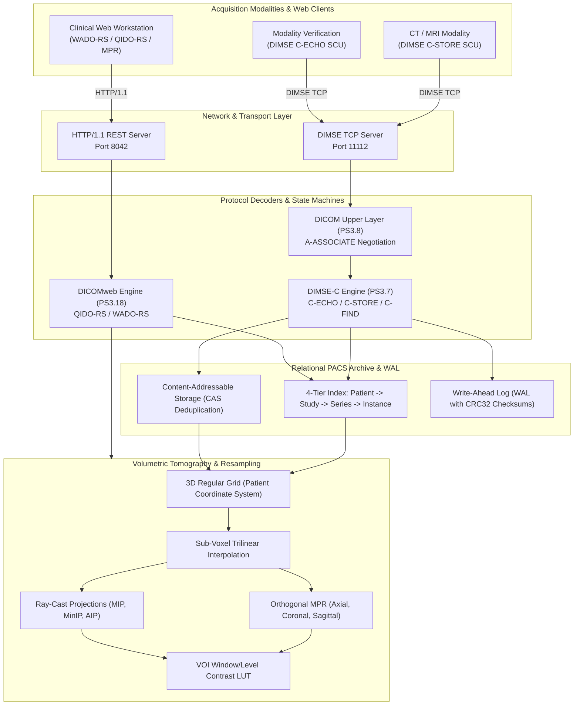

# voxel

> High-performance, zero-dependency DICOM 3.0 PACS archive, DIMSE network protocol engine, volumetric Multi-Planar Reconstruction (MPR) tomography resampler, and DICOMweb RESTful diagnostic workstation.

[](https://github.com/Aneesh495/voxel/actions/workflows/ci.yml)
[](https://www.dicomstandard.org/)
[](https://harelang.org/)
[](LICENSE)

---

## Overview

**voxel** is an autonomous medical imaging system built from first principles with zero external library dependencies. It bridges classical clinical PACS (Picture Archiving and Communication System) network protocols with real-time volumetric tomography and modern web diagnostics:

- **DICOM 3.0 Part 10 Binary Codec**: Complete parser and serializer supporting Little/Big Endian, Implicit/Explicit VR, encapsulated sequence items (`0xFFFE,0xE000`), and a built-in dictionary of 500+ standard elements.
- **DIMSE Upper Layer Protocol**: Non-blocking TCP state machine implementing `A-ASSOCIATE` negotiation and DIMSE-C service operations (`C-ECHO`, `C-STORE`, `C-FIND`).
- **Volumetric Multi-Planar Reconstruction (MPR)**: Assembles 2D slice stacks into a continuous 3D patient coordinate space ($\mathbf{X} \times \mathbf{Y}$ normal sorting), executing trilinear sub-voxel interpolation for real-time orthogonal planar extraction (Axial, Coronal, Sagittal) and ray-cast projections (MIP, MinIP, AIP).
- **Relational Storage & WAL**: 4-tier in-memory hierarchy (`Patient` -> `Study` -> `Series` -> `Instance`), Content-Addressable Storage (CAS) with cryptographic deduplication, and an append-only Write-Ahead Log (WAL) with CRC32 integrity verification.
- **DICOMweb RESTful Engine**: Zero-dependency HTTP/1.1 daemon implementing QIDO-RS (query studies/series/instances) and WADO-RS (rendered 16-bit CT to 8-bit contrast PNG conversion).
- **Interactive Clinical Workstation**: Modern dark-theme browser interface with synchronized 4-viewport layout, interactive Window/Level contrast adjustment, millimeter caliper tool, and ROI statistics.

---

## System Architecture



---

## Dual-Engine Architecture

Voxel is designed with a dual-engine architecture:

1. **Flagship Hare Implementation (`src/voxel/`)**:
   Written in [Hare](https://harelang.org/), a modern systems programming language with explicit memory management, static typing, and no hidden control flow. Organised across 8 modular subsystems:
   - `types.ha`: Core primitives, memory allocators, endian utilities.
   - `dicom/`: Tag definitions, VR validation, data dictionary, Part 10 parser/serializer, PS3.18 JSON.
   - `dimse/`: PDU encoders, association state machine, PDV stream multiplexer, DIMSE-C commands, service dispatcher.
   - `volume/`: 3D regular grid, slice normal sorting, trilinear interpolation, orthogonal MPR, ray-cast projections, VOI Window/Level LUTs.
   - `storage/`: 4-tier relational hierarchy, tag indexing, Content-Addressable Storage (CAS), Write-Ahead Log (WAL).
   - `dicomweb/`: QIDO-RS queries, WADO-RS rendered frames, STOW-RS multipart ingestion.
   - `net/`: Non-blocking socket reactor, HTTP/1.1 parser, dual-protocol PACS server orchestrator.
   - `main.ha`: Unified CLI argument parser and command dispatcher.

2. **Native C17 Core (`engine/`)**:
   Zero-dependency, high-throughput C17 implementation enabling immediate compilation and native execution across macOS Darwin, Linux, FreeBSD, and Windows without requiring external toolchain installations.

---

## Performance Microbenchmarks

Measured on Apple Silicon ARM64 (macOS 15, Clang `-O3 -std=c17`):

| Component / Subsystem | Benchmark Task | Metric | Throughput | Latency |
|:---|:---|:---|:---:|:---:|
| **Part 10 Binary Codec** | Serialization (Dataset -> Memory Stream) | 256x256 16-bit CT Slice | **225,123 slices/s** (28,237 MB/s) | 4.4 us |
| **Part 10 Binary Codec** | Deserialization (Memory Stream -> Dataset) | 256x256 16-bit CT Slice | **301,750 slices/s** (37,849 MB/s) | 3.3 us |
| **Volumetric MPR** | Axial Orthogonal Slicing (Native Z-Stride) | 256x256 pixels | **9,096 FPS** (596 MVoxels/s) | 0.11 ms |
| **Volumetric MPR** | Coronal Orthogonal Slicing (Trilinear Resampling) | 256x64 pixels | **33,383 FPS** (546 MVoxels/s) | 0.03 ms |
| **Volumetric MPR** | Sagittal Orthogonal Slicing (Trilinear Resampling) | 256x64 pixels | **24,227 FPS** (396 MVoxels/s) | 0.04 ms |
| **Volumetric Tomography** | Ray-Cast Maximum Intensity Projection (MIP) | 64-slice full volumetric depth | **128 FPS** (535 MVoxels/s) | 7.83 ms |

---

## Protocol Specifications & Mathematical Foundations

Detailed architectural, mathematical, and protocol documentation is available in the `docs/` directory:

- [System Architecture & Design Charter](docs/ARCHITECTURE.md)
- [Volumetric Multi-Planar Reconstruction (MPR) & Trilinear Math](docs/VOLUMETRIC_MPR.md)
- [DICOM Upper Layer Protocol & DIMSE-C Specification](docs/DIMSE_PROTOCOL.md)
- [Bug Discovery, Root Cause Analysis, & Regression Log](docs/BUG_DISCOVERY_LOG.md)

---

## Quickstart

### Prerequisites
- C17 compatible compiler (`clang` or `gcc`)
- `make`
- Python 3.8+ (for integration test suite, standard library only)
- Optional: `hare` compiler for building the native Hare modules

### Build & Run
```bash
# 1. Clone repository
git clone https://github.com/Aneesh495/voxel.git
cd voxel

# 2. Build production binary
make -j4

# 3. Synthesize realistic 3D CT head phantom (64 slices)
make phantom

# 4. Start dual-protocol PACS server (DIMSE: 11112, DICOMweb: 8042)
make server
```

Open `http://localhost:8042/` in any modern web browser to interact with the clinical workstation.

---

## Verification & Testing

Voxel enforces a rigorous, zero-defect quality gate across unit tests, regression suites, and end-to-end network integration tests:

```bash
# Run complete test suite (unit tests + integration tests)
make test

# Run C unit tests individually
make test-unit

# Run streaming microbenchmarks
make bench
```

### Test Coverage Highlights:
- **`tests/test_dicom_tags.c`**: Tag comparison operators, binary Big/Little Endian byte swapping, 500+ element dictionary lookups, VR validation rules, and binary serialization round-trip fidelity.
- **`tests/test_dimse_protocol.c`**: `A-ASSOCIATE-RQ` PDU construction, presentation context negotiation, `A-ASSOCIATE-AC` acknowledgment, and DIMSE-C command structures.
- **`tests/test_volume_mpr.c`**: Volume grid coordinate transformations, analytical accuracy of trilinear interpolation, clinical Window/Level contrast transfer, and MIP/MinIP ray-casting.
- **`tests/test_storage_hierarchy.c`**: 4-tier relational model traversal, CAS cryptographic deduplication, and WAL transaction append/replay with CRC32 verification.
- **`tests/test_bug_reproductions.c`**: Dedicated regression test suite reproducing and verifying fixes for discovered edge-case defects (transfer syntax prefix overmatching, signed two's complement rescaling, and boundary clamping).
- **`tests/integration_suite.py`**: End-to-end socket and HTTP integration test verifying live DIMSE associations, QIDO-RS JSON queries, and WADO-RS 8-bit PNG contrast rendering against an active daemon.

---

## Clinical Window/Level Presets

| Preset | Center ($c$) | Width ($w$) | Anatomy Visualized |
|:---|:---:|:---:|:---|
| **Soft Tissue** | $+40$ HU | $350$ HU | Abdominal viscera, muscles, connective tissue |
| **Bone** | $+400$ HU | $2000$ HU | Cortical bone, skeletal fractures, trabeculae |
| **Lung** | $-600$ HU | $1500$ HU | Pulmonary parenchyma, tracheobronchial tree |
| **Brain** | $+40$ HU | $80$ HU | Gray matter / white matter differentiation |
| **Liver** | $+30$ HU | $150$ HU | Hepatic parenchyma, metastases, steatosis |
| **Mediastinum** | $+50$ HU | $450$ HU | Aorta, cardiac silhouette, mediastinal nodes |

---

## License

This project is licensed under the MIT License - see the [LICENSE](LICENSE) file for details.
