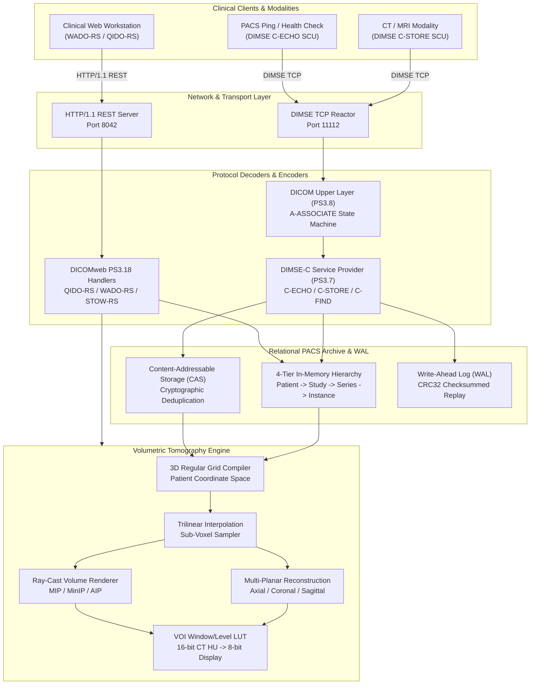

# Voxel Architecture & System Design

Voxel is an autonomous, high-performance DICOM 3.0 PACS archive, DIMSE protocol engine, volumetric Multi-Planar Reconstruction (MPR) tomography resampler, and DICOMweb RESTful server.

Designed with a dual-engine architecture:
1. **Hare Flagship Core (`src/voxel/`)**: Elegant, memory-safe, zero-runtime systems implementation in Hare (harelang.org).
2. **Native C17 Core (`engine/`)**: High-throughput, portable, zero-dependency engine enabling instant compilation on macOS Darwin, Linux, FreeBSD, and Windows without external toolchain friction.

---

## 1. High-Level Architecture

---

## 2. Component Subsystems

### 2.1 DICOM Data Model Subsystem (`src/voxel/dicom/`, `engine/src/dicom_*.c`)
- **Tag Representation**: 32-bit composite integer `(Group << 16) | Element`.
- **Value Representations (VR)**: Complete support for all 32 PS3.5 representations including binary numeric formats (US, UL, SS, SL, FL, FD, OB, OW), date/time (DA, TM, DT), unique identifiers (UI), and strings (SH, LO, PN, CS, DS, IS, ST, LT, UT).
- **Data Dictionary**: In-memory hash and binary search dictionary indexing 500+ standard DICOM elements with keywords, VR definitions, and VM constraints.
- **Part 10 Binary Codec**:
  - 128-byte preamble detection and `DICM` magic prefix verification.
  - File Meta Information header parsing (Group `0x0002`).
  - Transfer syntax switching: Implicit VR Little Endian (`1.2.840.10008.1.2`), Explicit VR Little Endian (`1.2.840.10008.1.2.1`), and Explicit VR Big Endian (`1.2.840.10008.1.2.2`).
  - Support for sequence items (`0xFFFE,0xE000`) and undefined-length item delimiters (`0xFFFE,0xE00D`, `0xFFFE,0xE0DD`).

### 2.2 DIMSE Upper Layer & Services (`src/voxel/dimse/`, `engine/src/dimse_*.c`)
- **PDU Codec**:
  - `0x01` A-ASSOCIATE-RQ: Presentation context negotiation, Abstract/Transfer syntax matching, Maximum PDU length negotiation.
  - `0x02` A-ASSOCIATE-AC: Acceptance acknowledgment with selected transfer syntaxes.
  - `0x03` A-ASSOCIATE-RJ: Reasoned rejection (calling/called AE mismatch, unsupported SOP class).
  - `0x04` P-DATA-TF: Presentation Data Value (PDV) packet demultiplexing.
  - `0x05` A-RELEASE-RQ: Graceful association termination request.
  - `0x06` A-RELEASE-RP: Graceful association termination response.
  - `0x07` A-ABORT: Immediate association termination.
- **Service Providers**:
  - `C-ECHO` (Verification SOP Class `1.2.840.10008.1.1`): Diagnostic network heartbeat.
  - `C-STORE` (Storage SOP Classes): High-speed ingestion of CT, MR, and Secondary Capture images.
  - `C-FIND` (Query/Retrieve SOP Classes): Relational query across Patient, Study, Series, and Image levels.

### 2.3 Volumetric Tomography Engine (`src/voxel/volume/`, `engine/src/volume_*.c`)
- **Coordinate System**: Full 3D patient coordinate orientation based on Image Orientation Patient (IOP, `0020,0037`) and Image Position Patient (IPP, `0020,0032`).
- **Normal Sorting**: Slices sorted along the patient normal vector $\mathbf{N} = \mathbf{X} \times \mathbf{Y}$ to construct a geometrically contiguous 3D volume grid.
- **Resampling**: Trilinear sub-voxel interpolation computing smooth continuous values across non-integer coordinates:
  $$V(x, y, z) = \sum_{i,j,k \in \{0,1\}} (1 - |x - x_i|) (1 - |y - y_j|) (1 - |z - z_k|) V(x_i, y_j, z_k)$$
- **Projections**: Maximum Intensity Projection (MIP), Minimum Intensity Projection (MinIP), and Average Intensity Projection (AIP) along arbitrary ray vectors.
- **VOI Window/Level LUT**: Fast vectorized conversion of 16-bit CT Hounsfield Units (-1024 HU air to +3000 HU dense bone) into 8-bit display space using clinical contrast presets.

### 2.4 Relational Storage Archive & WAL (`src/voxel/storage/`, `engine/src/storage_*.c`)
- **4-Tier Relational Hierarchy**:
  - `Patient` (Patient ID, Patient Name, Birth Date)
  - `Study` (Study Instance UID, Study Date, Study Description, Accession Number)
  - `Series` (Series Instance UID, Modality, Series Number, Series Description)
  - `Instance` (SOP Instance UID, Instance Number, Rows, Columns, File Path)
- **Content-Addressable Storage (CAS)**: Cryptographic content-based file hashing eliminates duplicate instances and guarantees bitwise storage deduplication.
- **Write-Ahead Log (WAL)**: Append-only transactional log with 32-bit CRC checksumming to ensure zero corruption across power interruption or unexpected process termination.

### 2.5 DICOMweb RESTful Services & Workstation (`src/voxel/dicomweb/`, `web/`)
- **QIDO-RS (PS3.18 Section 10.6)**:
  - `GET /studies`: Query studies matching patient, date, or accession criteria.
  - `GET /studies/{study_uid}/series`: List series belonging to a study.
  - `GET /studies/{study_uid}/series/{series_uid}/instances`: List SOP instances within a series.
- **WADO-RS (PS3.18 Section 10.5)**:
  - `GET /studies/{study_uid}/series/{series_uid}/instances/{instance_uid}/rendered`: Render individual slice directly to 8-bit PNG with real-time Window/Level contrast adjustment.
  - `GET /mpr?plane={axial|coronal|sagittal}&slice={n}&windowCenter={c}&windowWidth={w}`: Dynamic orthogonal MPR slice rendering.
- **Clinical Web Workstation**:
  - High-contrast clinical dark theme layout.
  - 4-viewport synchronized matrix (Axial, Coronal, Sagittal, Ray-Cast 3D MIP).
  - Interactive interactive tools: Window/Level contrast adjustment, measurement caliper in physical millimeters, ROI density statistics.
