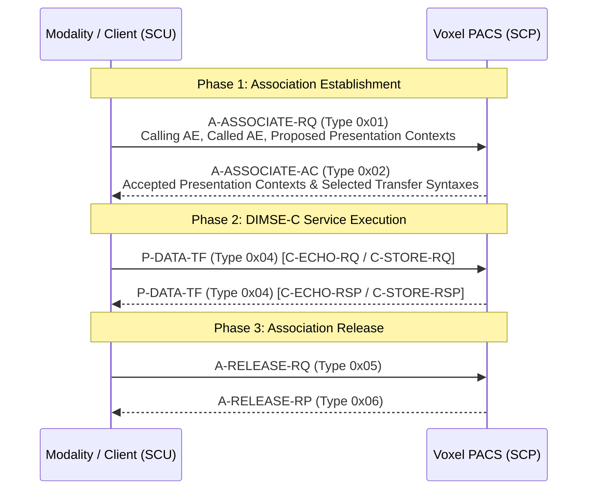

# DICOM Upper Layer Protocol & DIMSE-C Specification

This document describes the implementation of the DICOM Upper Layer Protocol (PS 3.8) and DICOM Message Service Element (DIMSE-C, PS 3.7) in Voxel.

---

## 1. Protocol Architecture & Layering

```
+-------------------------------------------------------------+
|                  Application Entity (AE)                    |
|           Verification (Echo), Storage, Query/Find          |
+-------------------------------------------------------------+
|                 DIMSE-C Service Provider                    |
|     C-ECHO, C-STORE, C-FIND Command Construct & Dispatch    |
+-------------------------------------------------------------+
|              DICOM Upper Layer Protocol (DUL)               |
|      A-ASSOCIATE State Machine, Presentation Contexts       |
+-------------------------------------------------------------+
|               Transport Layer Protocol (TCP)                |
|                    Port 11112 (Default)                     |
+-------------------------------------------------------------+
```

---

## 2. Association Negotiation Handshake

Before any medical imaging data can be exchanged over TCP, the Service Class User (SCU) and Service Class Provider (SCP) must establish an Association.



### 2.1 PDU Structure
Every Protocol Data Unit (PDU) begins with a fixed 6-byte header:
```
 0                   1                   2                   3
 0 1 2 3 4 5 6 7 8 9 0 1 2 3 4 5 6 7 8 9 0 1 2 3 4 5 6 7 8 9 0 1
+-+-+-+-+-+-+-+-+-+-+-+-+-+-+-+-+-+-+-+-+-+-+-+-+-+-+-+-+-+-+-+-+
|   PDU Type    |   Reserved    |          PDU Length           |
+-+-+-+-+-+-+-+-+-+-+-+-+-+-+-+-+-+-+-+-+-+-+-+-+-+-+-+-+-+-+-+-+
|                          PDU Length                           |
+-+-+-+-+-+-+-+-+-+-+-+-+-+-+-+-+-+-+-+-+-+-+-+-+-+-+-+-+-+-+-+-+
|                         PDU Data ...                          |
```

- **PDU Type (1 byte)**:
  - `0x01`: `A-ASSOCIATE-RQ`
  - `0x02`: `A-ASSOCIATE-AC`
  - `0x03`: `A-ASSOCIATE-RJ`
  - `0x04`: `P-DATA-TF`
  - `0x05`: `A-RELEASE-RQ`
  - `0x06`: `A-RELEASE-RP`
  - `0x07`: `A-ABORT`
- **Reserved (1 byte)**: Must be `0x00`.
- **PDU Length (4 bytes, Big-Endian)**: Total length of PDU body excluding the 6-byte header.

---

## 3. Presentation Context Negotiation

In `A-ASSOCIATE-RQ`, the SCU proposes one or more Presentation Contexts (`0x20` item type). Each Presentation Context item specifies:
1. **Presentation Context ID**: Unique odd integer ($1, 3, 5, \dots, 255$).
2. **Abstract Syntax Sub-Item (`0x30`)**: SOP Class UID indicating the service capability (e.g., `1.2.840.10008.1.1` Verification, `1.2.840.10008.5.1.4.1.1.2` CT Image Storage).
3. **Transfer Syntax Sub-Items (`0x40`)**: One or more proposed encoding schemes (Little Endian Explicit, Little Endian Implicit).

### 3.1 Supported SOP Classes
| SOP Class Name | UID | Mode |
|:---|:---|:---:|
| Verification SOP Class (C-ECHO) | `1.2.840.10008.1.1` | SCP |
| CT Image Storage (C-STORE) | `1.2.840.10008.5.1.4.1.1.2` | SCP |
| MR Image Storage (C-STORE) | `1.2.840.10008.5.1.4.1.1.4` | SCP |
| Secondary Capture Image Storage | `1.2.840.10008.5.1.4.1.1.7` | SCP |
| Study Root Query/Retrieve (C-FIND) | `1.2.840.10008.5.1.4.1.2.2.1` | SCP |

### 3.2 Supported Transfer Syntaxes
| Transfer Syntax Name | UID | VR Encoding | Byte Order |
|:---|:---|:---:|:---:|
| Explicit VR Little Endian | `1.2.840.10008.1.2.1` | Explicit | Little-Endian |
| Implicit VR Little Endian | `1.2.840.10008.1.2` | Implicit | Little-Endian |
| Explicit VR Big Endian | `1.2.840.10008.1.2.2` | Explicit | Big-Endian |

---

## 4. DIMSE-C Message Framing & PDV Format

All DIMSE-C messages are transmitted inside `P-DATA-TF` (`0x04`) PDUs as Presentation Data Values (PDVs).

### 4.1 PDV Packet Layout
Each PDV inside `P-DATA-TF` has a 5-byte header:
- **PDV Length (4 bytes, Big-Endian)**: Length of the remaining PDV data including the Message Control Header.
- **Presentation Context ID (1 byte)**: Matches the negotiated context ID.
- **Message Control Header (1 byte)**:
  - Bit 0 (`0x01`): `0` = Data Set fragment, `1` = Command Set fragment.
  - Bit 1 (`0x02`): `0` = Not the last fragment, `1` = Last fragment.

### 4.2 DIMSE-C Commands
- **`C-ECHO-RQ` (`0x0030`) / `C-ECHO-RSP` (`0x8030`)**:
  Used to verify network connectivity between modalities and Voxel PACS.
  Mandatory elements:
  - `(0000,0002)` Affected SOP Class UID (`UI`)
  - `(0000,0100)` Command Field (`US`)
  - `(0000,0110)` Message ID Being Responded To (`US`)
  - `(0000,0800)` Data Set Type (`US`, `0x0101` for command without dataset)
  - `(0000,0900)` Status (`US`, `0x0000` = Success)

- **`C-STORE-RQ` (`0x0001`) / `C-STORE-RSP` (`0x8001`)**:
  Transfers DICOM instances from acquisition modalities to Voxel PACS.
  Transmitted in two PDVs: first Command Set, followed by the Data Set containing metadata and raw pixel bytes.
  Voxel verifies the SOP Instance UID, stores the dataset in the Content-Addressable Storage (CAS), records a Write-Ahead Log (WAL) transaction, and responds with Status `0x0000` (Success).

- **`C-FIND-RQ` (`0x0020`) / `C-FIND-RSP` (`0x8020`)**:
  Enables modalities to search the PACS archive by Patient Name, ID, Accession Number, Modality, or Study Date.
  Returns matching records as Pending responses (`0xFF00`), concluding with a final Success response (`0x0000`).
